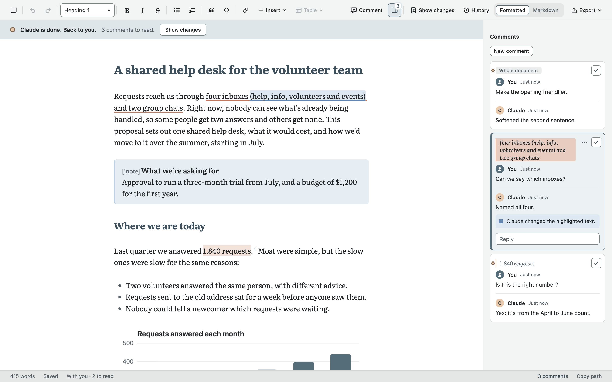
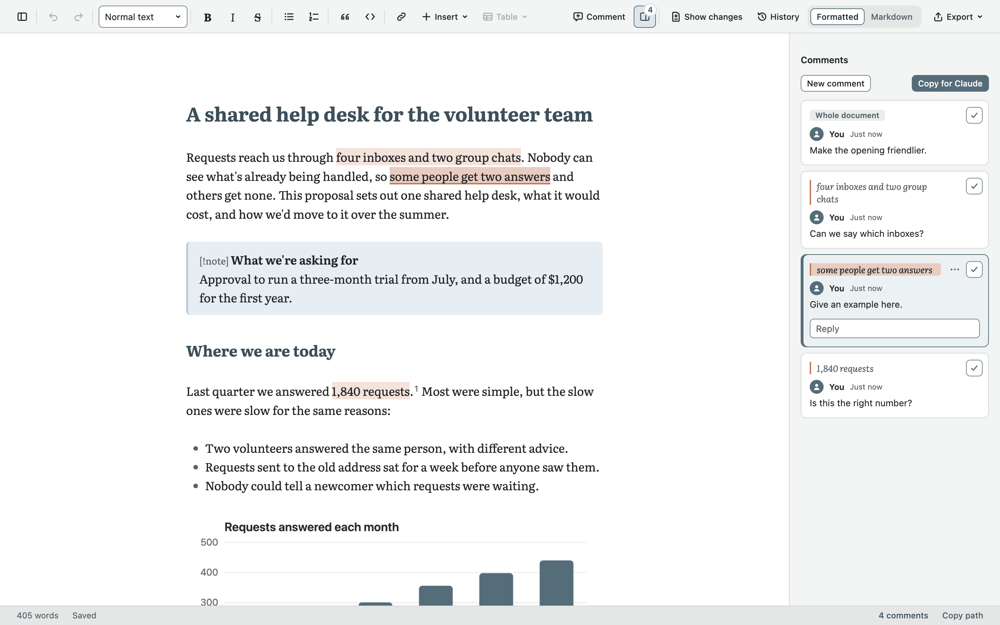
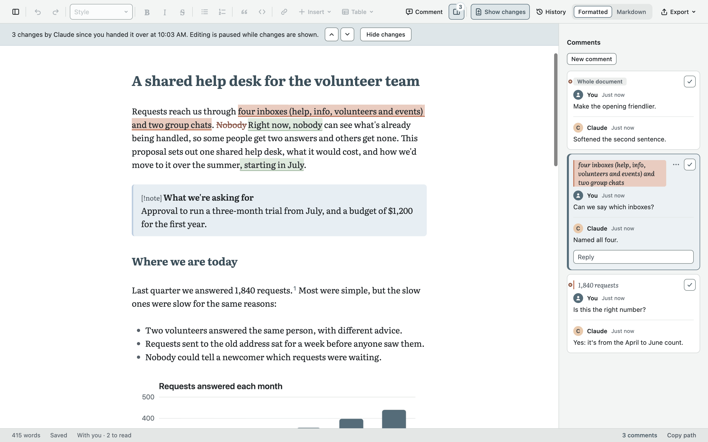
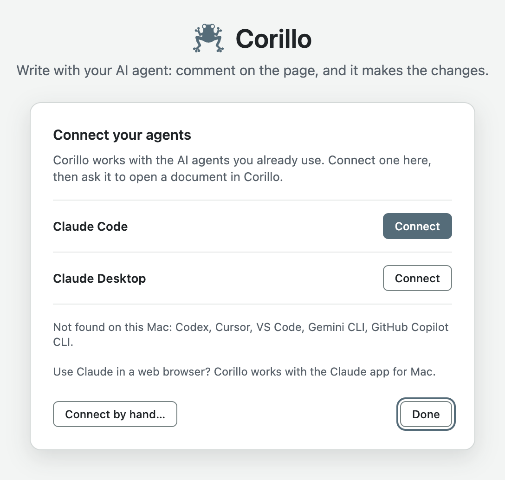

# Corillo

Corillo is a Mac app for writing documents with an AI agent such as Claude. You read the draft, leave comments on the page, and the agent makes the changes and replies to each comment. It works the way you'd review a document with a colleague.

It's for people who write with AI and would rather give feedback on the page than in a long chat. You don't need to be technical: there's no terminal, and nothing else to install.



*Claude has answered each comment. Click a comment, and the words Claude changed for it are highlighted on the page.*

## How it works

1. **Ask your agent for a draft.** In Claude, ask for what you need and add "open it in Corillo". The draft opens in Corillo.
2. **Comment on the page.** Select the words you want changed, click Comment, and say what you'd like. Comment on as many places as you want.
3. **Hand it back.** Click the button at the top of the Comments panel. The agent works through your comments, changes the text, and replies on each one.
4. **See what changed.** Click Show changes to see the agent's edits: new words highlighted, removed words struck through. Then resolve each comment that's done (the tick), or reply on any that isn't and hand it back again.



*Each comment sits beside the words it's about. When you're done, Copy for Claude (top right) hands them all to Claude at once.*



*Show changes: green is what Claude added, struck through in red is what it took out. The arrows at the top step through each change.*

Corillo keeps every version, so you can always look back at an earlier one or bring it back. When you're happy, export the document to Word or PDF.

Your documents are ordinary Markdown files (plain text with a little formatting), so other apps can open them too. Corillo keeps its comments and history on your Mac, never in your documents, and doesn't send your documents anywhere. Your agent reads a document when you ask it to work on one.

## What it needs

- A Mac with Apple silicon or an Intel processor, on macOS 13 Ventura or later.
- For Word: opening Word documents and exporting to Word need macOS 15 Sequoia or later. Everything else, PDF export included, works from macOS 13.
- An AI agent on your Mac, such as the Claude app for Mac (Claude Desktop) or Claude Code. Claude in a web browser can't reach apps on your Mac.
- Corillo connects with one click to Claude Code, Claude Desktop, Codex (also Codex in the ChatGPT app), Cursor, VS Code (for GitHub Copilot), Gemini CLI and GitHub Copilot CLI. Of these, only Claude Code and Claude Desktop have been tried in real use so far. Kiro CLI works too, connected by hand: it takes the same settings as Claude Desktop, in `~/.kiro/settings/mcp.json` (Help > Corillo Help > Connecting an agent by hand shows them).

## Install

The [Releases page](https://github.com/oneillo/corillo/releases) has two downloads, one for each kind of Mac. To see which kind you have, choose Apple menu > About This Mac:

- If it shows **Chip**, your Mac has Apple silicon. Download `Corillo-<version>-arm64.dmg`.
- If it shows **Processor**, your Mac has an Intel processor. Download `Corillo-<version>-x64.dmg`.

`<version>` is Corillo's version number, such as 0.1.0. Then:

1. Open the file you downloaded: double-click it in your Downloads folder. A window opens.
2. Drag Corillo onto the Applications folder in that window.
3. Open Corillo from your Applications folder.

### The first time you open it

I didn't pay Apple to sign Corillo, so the first time you open it, your Mac warns that it can't check Corillo and doesn't open it. Close the warning, and don't move Corillo to the Trash. Then follow the steps below for your version of macOS, to tell your Mac you trust Corillo (Apple menu > About This Mac shows your version). You do this once: after that, Corillo opens like any other app.

**On macOS 15 Sequoia and later:**

1. Choose Apple menu > System Settings, then click Privacy & Security in the sidebar.
2. Scroll down to Security. Beside the message about Corillo, click Open Anyway. The button is there for about an hour after you tried to open Corillo.
3. When the warning appears again, click Open (on some versions the button says Open Anyway).
4. If your Mac asks for your login password, enter it, then click OK.

**On macOS 13 Ventura and macOS 14 Sonoma:**

1. In the Finder, open your Applications folder. Don't use Launchpad for this.
2. Control-click Corillo, then choose Open from the menu.
3. Click Open.

Or use System Settings instead: choose Apple menu > System Settings, click Privacy & Security in the sidebar, scroll down to Security, and click Open Anyway beside the message about Corillo. The button is there for about an hour after you tried to open Corillo. When the warning appears again, click Open.

These are Apple's own steps, from [Open a Mac app from an unknown developer](https://support.apple.com/guide/mac-help/open-a-mac-app-from-an-unknown-developer-mh40616/mac) and [Safely open apps on your Mac](https://support.apple.com/en-us/102445). They let Corillo open and leave the rest of your Mac's security settings as they were.

## Connect Claude

1. The first time Corillo opens, it lists the AI tools it finds on your Mac. Click Connect beside the one you use.
2. Quit that tool completely (Command-Q) and open it again.
3. In Claude, ask: "Write a one-page plan for a team offsite, save it in my Documents folder and open it in Corillo." The first time, Claude may ask whether it can use Corillo: allow it.



*Corillo finds the AI tools on your Mac. Click Connect beside the one you use.*

To come back to this screen later, choose Help > Connect Agents… in Corillo.

To work on a document you already have, open it in Corillo, then tell Claude its name.

**Handing a document back.** With Claude Code, click Send to Claude: Claude is waiting for your review and starts straight away. With the Claude app, the button says Copy for Claude: click it, then paste into your chat with Claude.

## A personal project

I built Corillo for my own writing, and I'm sharing it as it is. I'll keep improving it for myself and put new versions here when I do, but I can't promise support, fixes or new versions.

To hear when a new version comes out, click Watch at the top of this page, then Custom > Releases (you need a GitHub account). To update, download the new version and drag it into Applications, replacing the old one. Your documents, comments and history stay as they were. Your Mac may ask you to trust Corillo again, with the same steps as the first time.

Ideas and fixes are welcome, as an issue or a pull request ([CONTRIBUTING.md](CONTRIBUTING.md) says how). I'll look at them when I can, and may not take every one.

## What works, and what doesn't yet

This is the first public version, 0.1.0.

What works:

- Writing and editing, with headings, lists, tables, pictures, links, footnotes and diagrams.
- Comments, replies and agent edits, with every change shown and every version kept.
- Export to Word and PDF, and opening a Word document as a copy you can work on.
- Help inside the app (Help > Corillo Help), with a first document step by step.

What doesn't, or hasn't been tried:

- **Mac only.** There's no Windows, Linux, iPhone or web version.
- **Only Claude Code, the Claude app and Kiro CLI have been tried in real use.** The other tools listed under What it needs connect the same way, but haven't been used day to day yet.
- **Just you and your agents.** Comments stay on your Mac. Corillo isn't for writing a document with other people.
- **Not signed by Apple,** so the first open needs the steps above.

## When something is wrong

- **Look in Help first.** Help > Corillo Help > Troubleshooting covers an agent that can't see Corillo, comments an agent didn't answer, and a document you can't type in.
- **An agent can't see Corillo.** Choose Help > Connect Agents… and look at your tool: Set up or Connected is fine, and Needs updating has an Update button. Quit and reopen the tool after any change.
- **Report a bug** by opening an [issue](https://github.com/oneillo/corillo/issues). Say what you did, what you expected and what happened, and give your macOS version and Corillo's version (Corillo > About Corillo). Leave out any document you don't want to make public.
- **A security problem** goes privately, not in an issue: see [SECURITY.md](SECURITY.md).

## Uninstall

1. **Disconnect your AI tools.** In Corillo, choose Help > Connect Agents… and click Disconnect beside each tool.
2. **Remove the app.** Quit Corillo, then drag it from your Applications folder to the Trash.
3. **Remove its data, if you won't come back.** Corillo keeps every document's comments and history in `~/Library/Application Support/Corillo`. To delete it, choose Go > Go to Folder in the Finder, paste that path, and move the folder to the Trash. Your documents are ordinary files and stay where they are.

<details>
<summary>If you removed Corillo before disconnecting</summary>

Delete the entry named `corillo` from each tool's settings file (Help > Corillo Help > Connecting an agent by hand shows what it looks like):

- Claude Code: `~/.claude.json`
- Claude Desktop: `~/Library/Application Support/Claude/claude_desktop_config.json`
- Codex: `~/.codex/config.toml`
- Cursor: `~/.cursor/mcp.json`
- VS Code: `~/Library/Application Support/Code/User/mcp.json`
- Gemini CLI: `~/.gemini/settings.json`
- GitHub Copilot CLI: `~/.copilot/mcp-config.json`
- Kiro CLI, if you connected it by hand: `~/.kiro/settings/mcp.json`

Beside a file Corillo changed is a copy of how it was before, ending in `.before-corillo`. You can delete it. Don't put it back in place of the settings file: it doesn't have any change the tool made since. Corillo's log, if it wrote one, is in `~/Library/Logs/Corillo`.

</details>

## How agents connect

Corillo connects to agents with MCP (the Model Context Protocol), the open standard most AI tools use to work with apps.

- **What Connect changes.** It adds one entry, named `corillo`, to the tool's own settings file, and changes nothing else in it. Disconnect takes it out again.
- **Nothing listens on the network.** The agent reaches Corillo through a small connector inside the app, over a local connection only your user account on this Mac can open. Corillo opens no network port. It goes online only to fetch a picture from the web that your document shows, and opens a link in your browser when you click it.
- **Only you resolve comments.** An agent can open, read and comment on a document, and change it once it has taken it for an editing pass. It can't resolve, edit or delete comments, or change the text while you're typing. You can take the document back at any time.

Corillo doesn't change what your AI tool already lets an agent do. An agent that can write your files with its own tools still can; Corillo shows such a change as "Changed outside Corillo" in History.

## Build from source

Corillo is built with Electron, TypeScript and ProseMirror. You need macOS, Node.js 24, and an internet connection for the first two steps.

```sh
npm ci                  # install what Corillo is built from
npm run fetch-pandoc    # download Pandoc into vendor/ (Word export and the tests need it)
npm test                # type check, build, unit tests, licence check, end-to-end tests
npm run package         # make release/Corillo.app and the disk image
```

- `npm run package` makes the app for the kind of Mac you run it on. To make the Intel app on an Apple silicon Mac, run `npm run package -- --arch=x64`.
- `npm test` takes about ten minutes on a recent Apple silicon Mac. The tests run Corillo with its window hidden, on throwaway folders, never your own.

[CONTRIBUTING.md](CONTRIBUTING.md) says how to make a change, and `dependencies.md` lists every dependency and its licence.

## Licence

Corillo is open source under the [MIT licence](LICENSE).

Word export uses [Pandoc](https://pandoc.org), which comes inside Corillo as a separate program under the GNU General Public License (version 2 or later). Corillo > About Corillo shows Pandoc's licence and links to its source code, with the licences of every other open source part of Corillo.

Microsoft Word, Claude and the other products named here are trademarks of their owners. Corillo works with them but isn't made, endorsed or sponsored by any of them.
