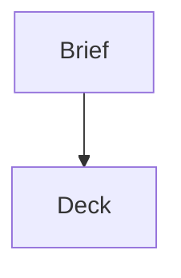

# Q3 planning #planning

Notes from the kickoff with [[Ana López]] and [[Team/Marcus|Marcus]]. See [[Q2 review#Lessons]] and [[Q2 review#^key-numbers|the key numbers]].
Budget is ==tight this quarter== and **==not negotiable==**. %%Ask finance about the [x] reserve.%%
This line follows a single line break, as Obsidian shows it.

> [!note] Why this matters
> Launch dates moved twice in Q2.
> We want one date we keep.

> [!tip]- Folded by default
> Keep the deck under ten slides.

> [!warning]
> No title on this one.

> [!question] Can callouts be nested?
> > [!todo] Yes, they can.
> > Like this.

> A plain quote stays a quote.

## Tasks

- [ ] Draft the brief #task
- [x] Book the room
	- [ ] Order coffee

- First idea ^idea-one
- Second idea, see [[#Tasks]]

^idea-list

## Pictures

![[chart.png]]

![[chart.png|300]]

![[Q2 review]]

The chart in Markdown: .

## Math and code

Growth is $r = \frac{a_1}{b_1}$ and prices are $5 and $10.

$$
\begin{vmatrix}a & b\\
c & d
\end{vmatrix}=ad-bc
$$

| Owner | Link |
| ----- | ---- |
| Ana   | [[Ana López\|Ana]] |
| Lee   | ![[chart.png\|100]] |

A footnote[^1] and an inline one.^[Written right here.]

[^1]: The footnote's text.

%%
A block comment.

It spans paragraphs, with a [[Hidden link]].
%%

HTML stays as it is.

Two spaces end this line  
and a backslash ends this one\
then the last line. #nested/tag/deep and #y1984 but not #1984. ^last-block
