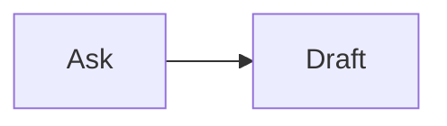

# Heading one

Body text with **bold**, *italic*, _underscore italic_, ***bold italic***, ~~struck~~, `inline code` and a [link with a title](https://example.com "Example").

## Heading two

### Heading three

#### Heading four

##### Heading five

###### Heading six

Underlined heading
------------------

## Line breaks

A single line break here
then the next line.
A backslash next\
then its line.
Two spaces next  
then their line.
A br tag next<br>then its line.

A paragraph after a blank line.

## Emphasis

Edge cases: snake_case_word, 2*3*4, a lone * star, **bold with `code` inside**, *italic with **bold** inside*, intra**word**bold, X**(firm)** and \*escaped stars\*.

Punctuation as typed: "straight quotes", it's, two -- hyphens, three --- hyphens and three... dots. Brackets: [Lists] stays in brackets.

## Links

An [inline link](https://example.com), a [reference link][ref], a [collapsed one][], <https://example.org/auto>, a bare https://example.net/bare and an email <ana@example.com>.

[ref]: https://example.com/ref "Reference"
[collapsed one]: https://example.com/collapsed

## Lists

- Tight one
- Tight two
  - Nested a
  - Nested b
    - Deeper
- Tight three

* Loose one

* Loose two

  With a second paragraph.

3. Starts at three
4. Four
   1. Nested numbered
   2. Nested two
5. Five

1. Mixed numbered
   - with bullets inside
   - two
2. Back to numbers

- [ ] Task open
- [x] Task done
  - [ ] Nested task

## Quotes

> A quote.
> Its second line.
>
> > A nested quote.

## Code

```
Plain code block
  indented line
```

```python
def hello():
    return "world"
```

    Indented code block



## Tables

| Left | Centre | Right |
|:-----|:------:|------:|
| a | b | c |
| line<br>break | <b>bold html</b> | **bold md** |

| One | Two | Three | Four | Five | Six | Seven | Eight |
|---|---|---|---|---|---|---|---|
| a long cell with several words in it | another long cell | more | and more text | still more | yes | no | the end of a wide table |

| Kept | As text |
|------|---------|
| has <sup>2</sup> | x |

## Pictures


![[chart.png|120]]

## Footnotes

A simple footnote[^simple], a complex one[^complex] and an inline one.^[Written right here.]

[^simple]: The simple note.

[^complex]: The complex note's first paragraph.

    Its second paragraph.

## Rules

Above the rules.

---

***

Below the rules.

## HTML

<div class="note">An HTML block.</div>

Inline <kbd>Cmd</kbd> and <u>underlined</u> HTML.

<!-- an HTML comment -->

## Entities and escapes

Entities: &copy; &amp; &lt;tag&gt; &#8212; dash. Escaped: \# \* \_ \[ \] \<.

## Obsidian

Links [[Plan]] and [[Plan#Goals|the goals]], ==highlighted==, #tag and #area/topic, %%a comment%% and a block id ^abc123

> [!note] Callout title
> Callout body.

> [!warning]
> Untitled callout.

%%
A block comment.
%%

## Math

Inline $x^2$ and a block:

$$
a^2 + b^2 = c^2
$$

## Odd cases

-

1.

>

The last paragraph.
