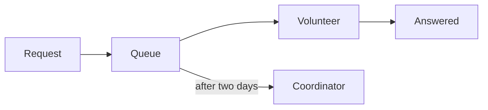

# A shared help desk for the volunteer team

Requests reach us through four inboxes and two group chats. Nobody can see what's already being handled, so some people get two answers and others get none. This proposal sets out one shared help desk, what it would cost, and how we'd move to it over the summer.

> [!note] What we're asking for
> Approval to run a three-month trial from July, and a budget of $1,200 for the first year.

## Where we are today

Last quarter we answered 1,840 requests.[^count] Most were simple, but the slow ones were slow for the same reasons:

- Two volunteers answered the same person, with different advice.
- Requests sent to the old address sat for a week before anyone saw them.
- Nobody could tell a newcomer which requests were waiting.

## What we propose

One queue for every request, whichever way it arrives. Each request shows who is handling it, and anything left for two days is flagged to the coordinator.

1. Pick a tool in June, from the three below.
2. Move the busiest inbox in July.
3. Move the rest in August, then close the old addresses.

| Option | Cost per year | Set-up time | Notes |
|--------|--------------:|-------------|-------|
| Tool A | Free | One afternoon | Up to five volunteers at once |
| Tool B | $1,200 | Two days | Unlimited volunteers, phone app |
| Tool C | $2,400 | A week | Built for larger charities |

## How we'll know it worked

By the end of September we expect every request to have an answer within two days, and no request answered twice. We'll ask the volunteers too: if the new desk makes their evenings harder, we'll go back.

### Risks

- Volunteers may keep answering from their own inboxes out of habit.
- Tool B's phone app needs a newer phone than some of us have.

### What we need from the board

A yes to the trial at the June meeting, and someone from the board to join the first training evening.[^training]

## Next steps

Ana will set up the trial account and invite the first five volunteers. Marcus will write a one-page guide for the team, and Lucía will move the busiest inbox once the guide is ready.

We'll report back at the September meeting with the numbers and what the volunteers said.

[^count]: Counted from the four inboxes and both group chats, April to June.
[^training]: Planned for the second Tuesday in July, at the community centre.
